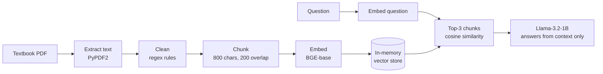

# Pathology RAG

A small retrieval-augmented generation (RAG) system that answers questions about lymphoma pathology using text from the *WHO Classification of Tumours of Haematopoietic and Lymphoid Tissues*. Everything runs locally: embeddings and generation both go through [Ollama](https://ollama.com), so no text leaves your machine.

The current version covers the diffuse large B-cell lymphoma (DLBCL) section of the textbook.

## How it works



1. **Ingestion.** `PyPDF2` extracts text from the textbook pages for the chosen section.
2. **Cleaning.** Textbook PDFs are noisy, so a set of regex rules removes inline citations (`{12,13}`, `[4]`), figure and table captions, running headers and page numbers, ICD-O codes, and stray symbols. It also rejoins words hyphenated across line breaks and merges wrapped lines back into paragraphs.
3. **Chunking.** LangChain's `RecursiveCharacterTextSplitter` splits the cleaned text into 800-character chunks with 200 characters of overlap, so a sentence that spans a boundary still appears whole in at least one chunk.
4. **Embedding.** Each chunk is embedded with `bge-base-en-v1.5` and stored in a simple in-memory vector store.
5. **Retrieval.** The question is embedded with the same model, and the three chunks with the highest cosine similarity are retrieved. Similarity is implemented from scratch so each step is easy to inspect.
6. **Generation.** `Llama-3.2-1B-Instruct` answers using only the retrieved passages. The system prompt tells it not to add information beyond the context, which limits hallucination. The retrieved chunks and their similarity scores are printed before the answer, so you can check what the answer is based on.

## Files

| File | What it does |
| --- | --- |
| `textbook_parser.py` | Full pipeline: extracts and cleans the textbook section, writes `dataset.txt`, chunks the text, builds the vector store, and starts the question-answering loop. |
| `model.py` | Lighter version that loads the sentence-level `dataset.txt` written by the parser and runs retrieval and generation over it. |
| `requirements.txt` | Python dependencies. |

## Setup

1. Install [Ollama](https://ollama.com) and pull the two models:

   ```sh
   ollama pull hf.co/CompendiumLabs/bge-base-en-v1.5-gguf
   ollama pull hf.co/bartowski/Llama-3.2-1B-Instruct-GGUF
   ```

2. Install the Python dependencies:

   ```sh
   pip install -r requirements.txt
   ```

3. Add the source PDF. The textbook is copyrighted, so it isn't included in this repo. Save your own copy as `WHO_classification_textbook.pdf` in the project folder. The parser reads pages 293–299 (the DLBCL section); change the page range in `textbook_parser.py` to use a different section.

## Usage

```sh
python textbook_parser.py
```

The script builds the vector store, then asks for a question:

```
Ask me a question: What are the molecular subtypes of DLBCL?
Retrieved knowledge:
 - (similarity: 0.xx) ...
Chatbot response:
...
```

After the parser has written `dataset.txt` once, `python model.py` runs the lighter sentence-level version.

## Next steps

- Evaluate retrieval and answer quality on a set of pathology questions with known answers.
- Extend ingestion beyond a single section, and store embeddings in a persistent vector database instead of rebuilding them on every run.
- Return citations (page numbers) with each answer.
